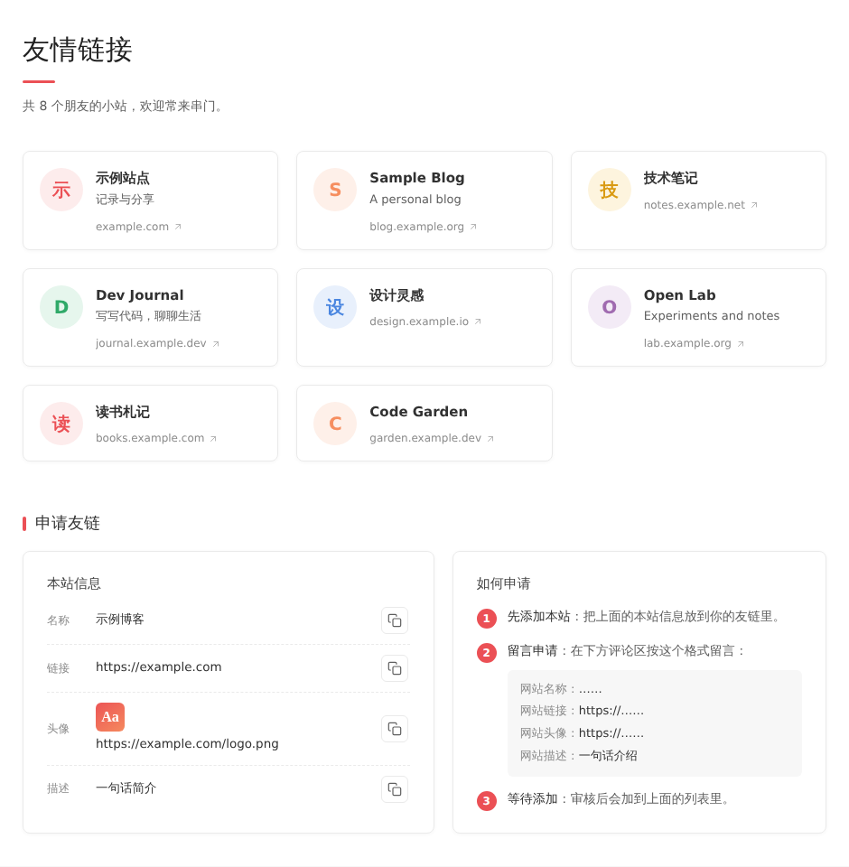
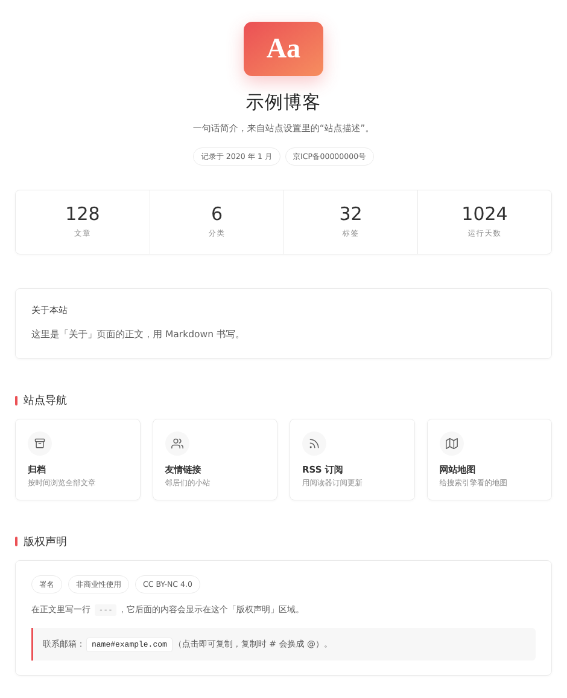

# Pinghsu Theme · Typecho 1.3 / PHP 8 edition

> **This is a fork of [chakhsu/pinghsu](https://github.com/chakhsu/pinghsu).**
> The design and nearly all of the code are the work of the original author, [Chakhsu Lau](https://github.com/chakhsu) (demo: [linpx.com](https://www.linpx.com)).
> This repository keeps the original **MIT license** and copyright notice (see [LICENSE.md](LICENSE.md)) and only adds the changes listed below. If you want the theme as the author made it, use the [original repository](https://github.com/chakhsu/pinghsu).

[简体中文](README.md)

## What this fork changes

The original was tested on PHP 7.0. On Typecho 1.3 + PHP 8.2 it prints `Deprecated` / `Warning` messages into the page (the footer of every page, the share bar and the previous/next links of post pages). This fork fixes them and adds two page templates.

### 1. Typecho 1.3 / PHP 8.2 compatibility

| File | Problem | Fix |
|---|---|---|
| `functions.php` → `getHotTags()` | Footer tag cloud. Since Typecho 1.2 `filter()` no longer returns `permalink`, and the tag rows were passed to the post widget: `Undefined array key "created"` / `"permalink"`, once per tag | Build the tag link with `\Typecho\Router::url('tag', …)` |
| `functions.php` → `theNext()` / `thePrev()` | Previous/next post links: same missing `permalink` | Use the core `\Widget\Contents\From` widget, which provides the permalink |
| `post.php` | Share buttons used `urlencode($this->permalink())` / `urlencode($this->title())`. Those methods echo and return `null`: PHP 8.1+ deprecation, and the share URLs were broken | Read the properties `$this->permalink` / `$this->title` |
| `comments.php` | (not a compatibility fix) outputs reCAPTCHA v3 after the comment form | Guarded with `class_exists('reCAPTCHAv3_Plugin')`, no effect without the plugin |

### 2. Two new page templates

| Page | File | Notes |
|---|---|---|
| Friend links | `page-links.php` | Responsive card grid (3 / 2 / 1 columns): coloured initial avatars (real image only when one is set), name, description, host; below it a "this site" box with copy buttons and apply instructions; the comment area stays for link requests. Reads the `links` table of the Links plugin (`state = 1`, ordered by `order`), and says so when the plugin is not enabled |
| About | `page-about.php` | Logo / title / description / ICP number, live stats (posts / categories / tags / days running), an intro card, navigation cards and an optional license panel |
| Shared | `pages.css`, `pages.js` | All styles are scoped under `.pg`, other theme pages are untouched. The script does click-to-copy and the number count-up. No external libraries or fonts, honours `prefers-reduced-motion` |

| Friend links | About |
|:--|:--|
|  |  |

(Site name, friends, e-mail etc. in the screenshots are placeholders.)

### Changed files

| File | Status |
|---|---|
| `functions.php` | modified (`getHotTags`, `theNext`, `thePrev`) |
| `post.php` | modified (4 share links) |
| `comments.php` | modified (1 line, optional reCAPTCHA) |
| `page-links.php`, `page-about.php`, `pages.css`, `pages.js` | **new** |
| `doc/page-links.png`, `doc/page-about.png` | **new** (screenshots) |
| `README.md`, `README_en.md` | modified (this notice on top, the original text below) |

Everything else is identical to upstream v1.6.2 (latest upstream commit `ed2e5f5`).

### Using the new pages

1. Copy the files over `usr/themes/pinghsu/`, same as installing the original.
2. In the admin: create a page and pick **Template Page of Links** or **Template Page of About** as its custom template.
3. **Links page** needs the Links plugin installed and enabled (it creates the `links` table; the page reads `name`, `url`, `description`, `image`, `state`, `order`). Manage friends in the plugin's admin page. A link without an image shows a coloured initial; image URLs containing `gravatar` are treated as placeholders and ignored.
4. **About page**: write the page body in Markdown. Everything **before** the first `---` goes into the "about" card, everything **after** it into the license panel (the panel is hidden when there is nothing after it). Title, description, logo (theme setting `logoUrl`) and ICP number (theme setting `ICPRecordNumber`) are read automatically. Navigation cards appear only when their target exists: the archive page (a page using `page-timeline.php`), the links page, RSS and the sitemap (needs the Sitemap plugin). Inside the body, `<code class="pg-mail" data-copy="name#example.com" data-at tabindex="0" role="button">name#example.com</code>` copies an address on click, turning `#` into `@`.

### Compatibility and limits

- **Tested only on Typecho 1.3.0 with PHP 8.2.** The changes use the namespaced APIs of newer Typecho (`\Typecho\Router`, `\Widget\Options`, `\Widget\Contents\From`, `\Utils\Markdown`); older versions were not tested, use the original theme there.
- Outside the theme, many older plugins have similar problems on Typecho 1.3 / PHP 8 (e.g. markdown editor plugins calling `markdown()` / `autoP()`, which became `protected`). They are out of scope for this repository.
- The page copy is Chinese; there is no i18n.

### Credits

- Original theme: [chakhsu/pinghsu](https://github.com/chakhsu/pinghsu) by **Chakhsu Lau**, MIT license.
- The changes in this fork are released under the MIT license as well.

---

# Original README

## Pinghsu Theme

[简体中文](README.md)

**Theme Introduction**

Pinghsu is a Typecho theme designed with a focus on frontend performance optimization while also considering aesthetic design and visual communication. The theme's name is a combination of the last letters of the author's name and his girlfriend's name in Hong Kong English, struggling between "Hsuping" and "Pinghsu." Eventually, it became Pinghsu, meaning everything is "Ping" (first) and then "Hsu" (last), indicating the need to listen to his girlfriend.

**Download Link**

https://github.com/chakhsu/pinghsu

**Theme Preview**

https://www.linpx.com

## Theme Highlights

 - Page preloading and DNS prefetching ensure extremely fast access speed.
 - No JQuery, no frontend frameworks, lightweight.
 - Almost zero code redundancy, almost every line of code is meaningful.
 - HighlightJS code highlighting, supporting 22 programming languages.
 - Responsive design, supporting tablets and mobile phones, with a browsing experience even better than desktop.
 - Supports image CDN mirroring, supports various article thumbnail settings.
 - Supports choosing between three-column and single-column homepages, article banners, and color blocks.
 - Supports article table of contents, related articles, and rendering of mathematical formulas.
 - Supports personalized badge settings for articles, with 10 badge choices.
 - Supports personal social buttons and social sharing.
 - XSS detection and prevention of multiple comment submissions added to theme settings.
 - And many more highlights waiting for you to discover!

## More Previews

|Homepage - Three Columns|Homepage - Single Column|
|:------|:------|
|||

|Article Content Page - Banner|Article Content Page - Table of Contents|
|:------|:------|
|||

|Page Content Page|Content Page - Comments|
|:------|:------|
|||

|Category Page|Template Archive Page|
|:------|:------|
|||

|Search Page|404|
|:------|:------|
|||

|Mobile - Homepage|Mobile - Article Page|Mobile - Category Page|
|:------|:------|:------|
||||

## Theme Usage

**Note**: Currently, the theme has only been tested on the Typecho development version and PHP 7.0. Other scenarios have not been extensively tested.

Download from Github by clicking "Download ZIP", then after extraction, rename the folder to `pinghsu`, upload it to `/usr/themes`, and activate the theme.

If you need to update the theme, download the latest files, then overwrite the original files to complete the update. Some newly added features need to be enabled in the backend to take effect.

## Appearance Settings

Appearance settings are mainly divided into four parts: logo and icon settings, feature toggles, social button settings, and image CDN mirroring.

The usage notes are fairly clear in the settings. If you encounter any unclear points, feel free to leave me a message for feedback.

Here are a few additional points:

 - CDN settings have only been tested with Qiniu, theoretically also supporting CDN services with mirroring capabilities.
 - When creating a template archive page, regardless of which template is chosen, you must add the custom field `archive`.

**Separate Search Page**

Check here for setup instructions: [Here](https://www.linpx.com/p/add-a-separate-search-page-to-the-pinghsu-theme.html)

**Article Thumbnails**

There are four methods for setting article thumbnails: custom field `thumb`, the first image attachment, images within the article, default thumbnails.

Priority order: custom field thumb -> first image attachment -> images within the article -> default thumbnail -> random image -> none.

Thumbnail dimensions should be at least 250px in height, with a width greater than the height. A recommended height is 400px.

**Personalized Badges**

Personalized badges appear on the homepage, category pages, tag pages, author pages, and related articles.

The method for setting badges is to fill in custom fields while editing the article. Supported fields include:

`book`, `game`, `note`, `chat`, `code`, `image`, `web`, `link`, `design`, `lock`

**Personalized Color Blocks**

To activate personalized color blocks, you need to enable them in the appearance settings. Color blocks appear on the homepage, category pages, tag pages, separate search pages, and more.

The method for setting color blocks is to fill in custom fields while editing the article. Supported fields include:

`blue`, `purple`, `green`, `yellow`, `red`

**Friendship Links**

If you want to create a friendship links page like mine, since it's the Typecho development version, it supports writing `<ul><li>` within a page.

So you can directly inline a `class="flinks"` within `<ul>`, then insert your friendship links within `<li>`.

More setup tutorials: [Here](https://www.linpx.com/p/more-detailed-pinghsu-theme-set-tutorial.html)

## Browser Compatibility

Well... modern browsers are all compatible...

## Contributing

All kinds of contributions (enhancements, new features, documentation & code improvements, issues & bugs reporting) are welcome.

## License

Open sourced under the MIT license.
